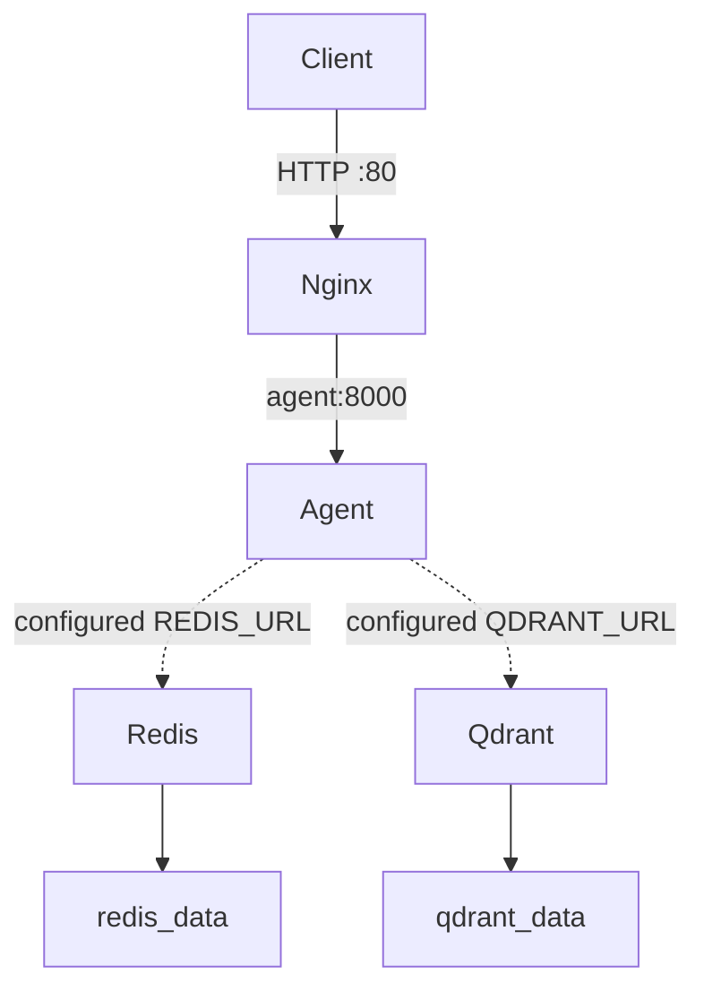
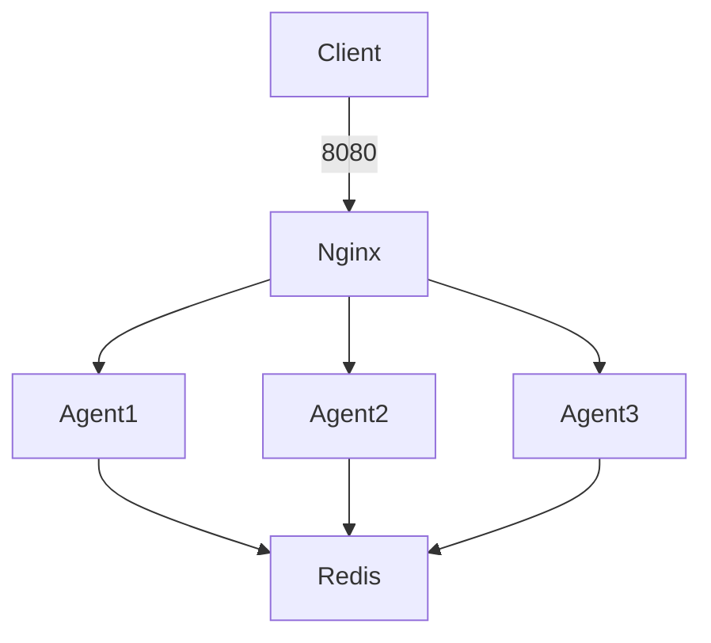

# Day 14 Lab — Mission Answers

## CP0 — Setup

- Repository: đúng mẫu tên Day 14; remote origin thuộc tài khoản cá nhân, nhánh main.
- Python Windows: 3.15.2; môi trường làm bài chọn Ubuntu 24.04 WSL, Python 3.12.3, os.name = posix.
- Docker Compose trên Windows: v5.5.1.
- Đã tạo virtual environment WSL tại ~/.venvs/k5day14 và cài dependencies Part 1 thành công.
- Docker Desktop đã được bật và kiểm tra lại thành công: Docker Engine 29.8.1, Docker Compose v5.5.1 trên WSL. Lệnh docker run --rm hello-world trả về Hello from Docker! trên cả Windows và Ubuntu-24.04 WSL. Python 3.12.3 trong virtual environment vẫn hoạt động. CP0 đạt toàn bộ yêu cầu setup đã kiểm tra.

## Part 1 — Localhost vs Production (CP1)

### Exercise 1.1 — Anti-patterns

Các dòng dưới đây thuộc `01-localhost-vs-production/develop/app.py`.

1. Dòng 17–18: API key mẫu và database URL được hardcode, dễ lộ thông tin nếu dùng credential thật và khó đổi theo môi trường.
2. Dòng 21–22: DEBUG và MAX_TOKENS cố định trong source, không có quản lý cấu hình theo môi trường.
3. Dòng 33–38: dùng print để ghi cả câu hỏi, câu trả lời và key; dễ lộ dữ liệu, khó lọc log tập trung.
4. Dòng 42–43: thiếu endpoint health check chuyên biệt để platform kiểm tra liveness.
5. Dòng 51: bind localhost, không nhận traffic từ bên ngoài container.
6. Dòng 52: port 8000 cố định, không tuân theo PORT do cloud cấp.
7. Dòng 53: reload=True gây overhead và không phù hợp production.
8. Không khai báo lifecycle startup/shutdown để quản lý và giải phóng tài nguyên; Uvicorn vẫn có cơ chế shutdown mặc định.

### Exercise 1.2 — Chạy bản develop

Chạy trong WSL Ubuntu 24.04, Python 3.12.3 với dependencies từ requirements.txt và PYTHONPATH trỏ gốc repo. Dùng Uvicorn trực tiếp để không bật reload khi kiểm thử.

```bash
python -m uvicorn app:app --host 127.0.0.1 --port 8000
curl -i -X POST "http://127.0.0.1:8000/ask?question=Hello"
```

Output thực tế (25/11/2026, lược bỏ header không cần thiết):

```text
HTTP/1.1 200 OK
{"answer":"Tôi là AI agent được deploy lên cloud. Câu hỏi của bạn đã được nhận."}
```

Đây là câu trả lời mock chạy local, không chứng minh đã deploy cloud. API chạy được nhưng chưa production-ready vì các vấn đề ở Exercise 1.1.

### Exercise 1.3 — So sánh với advanced

| Feature | Develop | Production | Tại sao quan trọng? |
| --- | --- | --- | --- |
| Config | Hardcode, dòng 17–22 | config.py đọc env, validate | Đổi cấu hình không sửa code, không đưa secret vào Git |
| Health check | Không có | /health dòng 135–149, /ready dòng 152–161 | Phân biệt process sống với khả năng nhận request |
| Logging | print và log key, dòng 33–38 | Logging có format JSON dòng 28–31, chỉ ghi metadata dòng 110–122 | Dễ tìm lỗi và giảm lộ dữ liệu; formatter mẫu vẫn cần xử lý escaping khi dùng thực tế |
| Shutdown | Không có lifecycle riêng | lifespan dòng 39–67, Uvicorn xử lý shutdown | Cho phép hoàn tất request và cleanup tài nguyên |
| Host/port | localhost:8000 dòng 51–52 | settings.host, settings.port dòng 196–197 | Nhận kết nối từ bên ngoài container, phù hợp cloud |
| Debug | reload=True dòng 53 | settings.debug dòng 198, mặc định false | Giảm overhead production |
| Input | Query parameter | JSON body, kiểm tra question dòng 102–108 | Hợp đồng API rõ hơn |

Đã tắt develop trước khi chạy production/app.py (config mặc định, mock LLM). Kết quả thực tế:

```text
GET /health — HTTP/1.1 200 OK
{"status":"ok","uptime_seconds":0.6,"version":"1.0.0","environment":"development","timestamp":"2026-11-25T07:41:21.501827+00:00"}
GET /ready — HTTP/1.1 200 OK
{"ready":true}
POST /ask (JSON {"question":"Hello"}) — HTTP/1.1 200 OK
{"question":"Hello","answer":"Tôi là AI agent được deploy lên cloud. Câu hỏi của bạn đã được nhận.","model":"gpt-4o-mini"}
INFO:     Shutting down
INFO:     Waiting for application shutdown.
INFO:     Application shutdown complete.
```

Ví dụ cụ thể: develop/app.py dòng 52 cố định port 8000, production/app.py dòng 197 dùng settings.port, được đọc từ PORT trong config.py. Health check giúp phát hiện process lỗi, readiness giúp điều phối traffic; graceful shutdown giúp giảm request bị ngắt. Bản advanced là ví dụ cải tiến, chưa chứng minh đủ tiêu chí Part 6.

## Part 2 — Docker (CP2)

### Exercise 2.1 — Dockerfile cơ bản

1. Base image: `python:3.11`, bản Python đầy đủ.
2. Working directory: `/app`; các lệnh COPY, RUN và CMD làm việc từ đây nếu dùng đường dẫn tương đối.
3. COPY requirements.txt trước source giúp cache layer pip install; thay đổi app.py không buộc cài lại dependencies nếu requirements không đổi.
4. CMD đặt lệnh hoặc tham số mặc định, có thể ghi đè bằng đối số docker run. ENTRYPOINT định nghĩa executable chính, thường kết hợp CMD làm tham số mặc định; có thể thay bằng --entrypoint.

### Exercise 2.2 — Build và run

Chạy từ gốc repo:

```bash
docker build -f 02-docker/develop/Dockerfile -t my-agent:develop .
docker run -d --name k5-day14-cp2-dev -p 127.0.0.1:8000:8000 my-agent:develop
curl -i http://127.0.0.1:8000/health
curl -i -X POST 'http://127.0.0.1:8000/ask?question=What%20is%20Docker%3F'
docker logs --tail 8 k5-day14-cp2-dev
docker exec k5-day14-cp2-dev python --version
docker rm -f k5-day14-cp2-dev
```

Output thực tế ngày 25/11/2026 (lược bỏ header):

```text
GET /health — HTTP/1.1 200 OK
{"status":"ok","uptime_seconds":1.2,"container":true}
POST /ask — HTTP/1.1 200 OK
{"answer":"Container là cách đóng gói app để chạy ở mọi nơi. Build once, run anywhere!"}
Python 3.11.18
```

Endpoint develop nhận question qua query parameter theo README. docker logs xác nhận server Uvicorn và hai endpoint trả 200.

### Exercise 2.3 — Multi-stage build

Stage builder dùng python:3.11-slim, cài gcc, libpq-dev và Python dependencies vào /root/.local. Stage runtime dùng base slim mới, chỉ copy packages đã cài và source, chạy bằng appuser non-root, có HEALTHCHECK và 2 Uvicorn workers. Không mang build tools sang runtime.

```bash
docker build -f 02-docker/production/Dockerfile -t my-agent:advanced .
docker images my-agent
docker image inspect my-agent:develop my-agent:advanced --format '{{.RepoTags}} {{.Size}}'
```

| Image | ID | Disk usage (docker images) | Content size | Size (bytes, inspect) |
| --- | --- | --- | --- | ---: |
| my-agent:develop | 47f32f42f8f1 | 1.67 GB | 426 MB | 1667783957 |
| my-agent:advanced | 1ba7fb337d63 | 240 MB | 57.4 MB | 239815436 |

Dung lượng theo MB thập phân: 1667.783957 MB và 239.815436 MB. Giảm (1667783957 - 239815436) / 1667783957 x 100 = 85.62%. Image advanced dưới 500 MB. Docker HEALTHCHECK đánh dấu tình trạng container; Docker standalone không tự restart chỉ vì unhealthy.

### Exercise 2.4 — Docker Compose



Bốn service cùng mạng bridge internal, chỉ Nginx publish port 80/443 (chưa có TLS listener trong cấu hình mẫu). Agent phụ thuộc healthcheck Redis và Qdrant; bản main.py mẫu dùng Mock LLM, chưa thực sự truy vấn hai dịch vụ này. Compose khởi động một container agent (hai worker), không phải hai replica như comment. Nginx proxy vào agent:8000, rate limit theo IP. Volume lưu dữ liệu Redis và Qdrant.

Tạo .env.local rỗng (không commit), chạy compose với project riêng:

```bash
docker compose -p k5-day14-docker -f 02-docker/production/docker-compose.yml up -d --build --wait
docker compose -p k5-day14-docker -f 02-docker/production/docker-compose.yml ps
curl -i http://127.0.0.1/health
curl -i -X POST http://127.0.0.1/ask -H 'Content-Type: application/json' -d '{"question":"Explain microservices"}'
docker compose -p k5-day14-docker -f 02-docker/production/docker-compose.yml exec -T agent id
```

Output thực tế: agent, redis, qdrant healthy; nginx Up. Qua Nginx:

```text
GET /health — HTTP/1.1 200 OK
Server: nginx
{"status":"ok","uptime_seconds":5.0,"version":"2.0.0","timestamp":"2026-11-25T07:52:27.377287"}
POST /ask — HTTP/1.1 200 OK
Server: nginx
{"answer":"Tôi là AI agent được deploy lên cloud. Câu hỏi của bạn đã được nhận."}
uid=999(appuser) gid=999(appuser) groups=999(appuser)
```

Log Nginx xác nhận POST /ask 200. Đã dọn stack bằng docker compose -p k5-day14-docker -f 02-docker/production/docker-compose.yml down -v. Compose cảnh báo version obsolete nhưng không ảnh hưởng test.

## Part 3 — Cloud Deployment (CP6)

Chọn Railway để deploy agent Part 6 trong 06-lab-complete cùng Redis. CP5 đã đạt PASS 12/12 local. Railway CLI 5.75.0 đã cài và đăng nhập thành công. Project day14-agent có agent và Redis đều SUCCESS. URL public: https://agent-production-37de1463.up.railway.app. HTTP thực tế: GET /health 200, GET /ready 200, POST /ask không key 401, POST /ask có key 200. Đã bổ sung ba screenshot cloud do học viên chụp: screenshots/dashboard.png, screenshots/running.png, screenshots/test.png.

### Railway và Render

| Tiêu chí | railway.toml | render.yaml |
| --- | --- | --- |
| Build | builder DOCKERFILE | runtime docker, rootDir 06-lab-complete |
| Health | healthcheckPath /health | healthCheckPath /health |
| Redis | Tạo Redis service trong project, tham chiếu REDIS_URL | Blueprint khai báo Key Value service và fromService connectionString |
| Secret | Đặt AGENT_API_KEY trong Variables | generateValue cho AGENT_API_KEY |
| Port | Docker CMD đọc PORT | Docker CMD đọc PORT |

### Exercise 3.3 — Cloud Run

cloudbuild.yaml mẫu chạy pytest, build image với tag COMMIT_SHA và latest, push registry, sau đó dùng gcloud run deploy tại asia-southeast1.
service.yaml mô tả cấu hình IaC: 1–10 instances, concurrency 80, timeout 60s, CPU/RAM, liveness /health và startup /ready.
Secret Manager cung cấp credential qua biến môi trường thay vì hardcode; nếu áp dụng cho agent CP5 phải bổ sung Redis và kết nối riêng.
Đây là phân tích pipeline mẫu, không triển khai GCP.

## Part 4 — API Security (CP3)

### Exercise 4.1 — API key

APIKeyHeader đọc X-API-Key; verify_api_key được inject qua Depends vào POST /ask. Thiếu key trả 401, sai key trả 403, đúng key cho phép xử lý. Rotate bằng cách đổi AGENT_API_KEY qua secret manager hoặc biến môi trường, restart service và cập nhật client; không ghi key thật vào Git. Bản mẫu có default demo và print key khi chạy trực tiếp, không nên dùng cách đó trong production.

Test trên WSL, chạy Uvicorn trực tiếp với key demo theo README. Output curl -i thực tế (lược header không liên quan):

```text
HTTP/1.1 401 Unauthorized
{"detail":"Missing API key. Include header: X-API-Key: <your-key>"}
HTTP/1.1 403 Forbidden
{"detail":"Invalid API key."}
HTTP/1.1 200 OK
{"question":"Hello","answer":"Tôi là AI agent được deploy lên cloud. Câu hỏi của bạn đã được nhận."}
```

### Exercise 4.2 — JWT

Client gửi thông tin đăng nhập demo tới POST /auth/token (theo README), server authenticate_user kiểm tra và create_token ký HS256 với sub, role, iat, exp (60 phút). Client gửi Authorization: Bearer token; verify_token xác minh chữ ký và hạn, trả username và role. JWT được ký chứ không mã hóa; không đưa thông tin nhạy cảm vào payload. Secret mặc định và user demo chỉ dùng local.

Đã tắt server develop trước khi chạy production. Dùng Python urllib gửi HTTP request tương đương curl, không ghi token vào output. Kết quả thực tế:

```text
POST /ask (không token): 401
www-authenticate: Bearer
{"detail":"Authentication required. Include: Authorization: Bearer <token>"}
POST /auth/token: 200
{"token_type":"bearer","expires_in_minutes":60}
POST /ask (Bearer [REDACTED]): 200
{"question":"Explain JWT","answer":"Đây là câu trả lời từ AI agent (mock). Trong production, đây sẽ là response từ OpenAI/Anthropic.","usage":{"requests_remaining":9,"budget_remaining_usd":0.000021}}
```

### Exercise 4.3 — Rate limiting

Sliding window theo timestamp: mỗi user có deque, xóa timestamp cũ hơn 60 giây, kiểm tra độ dài, thêm timestamp khi cho phép. User thường 10 req/phút; admin 100 req/phút qua role đã xác thực, không phải bypass vô hạn. State in-memory chỉ phù hợp demo một process.

Vòng lặp 20 request HTTP liên tiếp với token student (đã gọi 1 request ở Exercise 4.2): request 1–9 trả 200, request 10–20 trả 429. Tổng 10 request được xử lý, 11 bị chặn.

```text
Request 10: HTTP 429
x-ratelimit-limit: 10
x-ratelimit-remaining: 0
x-ratelimit-reset: 1795593351
retry-after: 59
{"detail":{"error":"Rate limit exceeded","limit":10,"window_seconds":60,"retry_after_seconds":59}}
```

GET /me/usage trả 200, requests=10, input_tokens=40, output_tokens=300, cost_usd=0.000186, budget_usd=1.0, budget_remaining_usd=0.999814. Đây là chi phí giả lập, không phát sinh bill LLM.

### Exercise 4.4 — Cost guard

Bản mẫu CostGuard theo dõi token và chi phí trong RAM, giới hạn 1 USD/ngày/user và 10 USD/ngày toàn hệ thống, cảnh báo 80%, trả 402 khi vượt budget user hoặc 503 khi vượt global. Code mẫu chưa reset global counter khi sang ngày; trường budget_remaining_usd trong /ask thực ra trả tổng cost, còn /me/usage trả remaining đúng.

Thiết kế cho yêu cầu 10 USD/tháng/user: dùng Redis key budget:{user_id}:{YYYY-MM} theo UTC; lưu chi phí bằng integer micro-USD (10 USD = 10000000), đặt expiry đến đầu tháng kế tiếp. Dùng Lua hoặc transaction WATCH/MULTI/EXEC để kiểm tra current + estimated_cost và reserve atomically trước khi gọi LLM; nếu vượt thì từ chối 402. Sau khi hoàn thành, reconcile chi phí thực tế, giải phóng phần reserve dư hoặc khi request thất bại. Key tháng mới tự bắt đầu từ 0, không phụ thuộc restart. Nếu Redis lỗi, fail closed. Rate limiter hạn chế tốc độ, cost guard hạn chế tổng chi phí; cả hai cần thiết vì mỗi request có số token khác nhau. Phần này là giải thích thiết kế theo CHECKPOINTS.md; triển khai Redis ở CP5.

## Part 5 — Scaling & Reliability (CP4)

### Exercise 5.1 — Health checks

Liveness /health kiểm tra process còn hoạt động; readiness /ready xác định khả năng nhận traffic. Khi dependency như Redis lỗi, production cần giữ liveness 200 nếu process còn sống và readiness 503 để loại instance khỏi traffic. Bản develop dùng cờ _is_ready trong lifespan và psutil để báo tình trạng bộ nhớ, chưa kiểm tra Redis.

Chạy develop/app.py bằng Python 3.12.3 trong WSL, cài requirements.txt. Output thực tế (25/11/2026):

```text
GET /health: HTTP 200
{"status":"ok","uptime_seconds":0.3,"version":"1.0.0","environment":"development","timestamp":"2026-11-25T08:01:45.557861+00:00","checks":{"memory":{"status":"ok","used_percent":16.3}}}
GET /ready: HTTP 200
{"ready":true,"in_flight_requests":1}
```

### Exercise 5.2 — Graceful shutdown

Uvicorn xử lý SIGTERM, ngừng nhận kết nối mới, chờ request hiện tại hoàn tất rồi gọi lifespan shutdown để cleanup. Bản mẫu cấu hình timeout_graceful_shutdown=30 và theo dõi in-flight requests. SIGKILL không cho phép cleanup.

Test bằng subprocess và HTTP client trong WSL: gửi POST /ask?question=Long%20task, đợi 0.8 giây rồi gửi SIGTERM khi future chưa hoàn thành. Output:

```text
Sending SIGTERM while request pending: True
IN-FLIGHT RESPONSE (200, '{"answer":"Agent đang hoạt động tốt! (mock response) Hỏi thêm câu hỏi đi nhé."}')
Elapsed seconds 3.01
Process exit 0
INFO: Shutting down
POST /ask?question=Long%20task HTTP/1.1 200 OK
INFO: Waiting for application shutdown.
Graceful shutdown initiated...
Shutdown complete
INFO: Application shutdown complete.
```

Request hoàn thành trước khi process thoát, không bị mất response.

### Exercise 5.3 — Stateless design

Nếu history nằm trong dict RAM, mỗi replica có bản riêng; request tiếp theo đến replica khác sẽ không thấy history, restart làm mất dữ liệu. Bản production dùng Redis chung, key session:{session_id}, TTL 3600 giây, tối đa 20 messages. Client gửi lại session_id để mọi instance đọc và ghi cùng session.

Bản mẫu có fallback RAM khi không kết nối Redis lúc khởi động, nên chỉ stateless khi USE_REDIS=True. Read-modify-write history chưa atomic khi nhiều request đồng thời cùng session; production thực sự cần Redis transaction hoặc thao tác atomic. Mock LLM chỉ dùng câu hỏi hiện tại, không suy luận từ history.

### Exercise 5.4 — Load balancing

Tạo .env.local rỗng (ignored), chạy từ 05-scaling-reliability/production:

```bash
docker compose -p k5-day14-scaling up -d --build --scale agent=3 --wait
docker compose -p k5-day14-scaling ps
curl -i http://127.0.0.1:8080/health
curl -i http://127.0.0.1:8080/ready
python test_stateless.py
```



Compose ps: agent-1, agent-2, agent-3 và redis healthy; nginx Up. Nginx dùng upstream agent:8000 qua Docker DNS và X-Served-By để quan sát upstream. Hai health request trả HTTP 200; /health báo storage=redis và redis_connected=true.

### Exercise 5.5 — Test stateless

Output thực tế của test_stateless.py:

```text
Session ID: d362a0c7-5b79-4f49-872e-54b19db32daa
Request 1: [instance-b3abc4]
Request 2: [instance-4710f6]
Request 3: [instance-5c5ccc]
Request 4: [instance-b3abc4]
Request 5: [instance-4710f6]
Total requests: 5
Instances used: {'instance-b3abc4', 'instance-4710f6', 'instance-5c5ccc'}
Total messages: 10
Session history preserved across all instances via Redis!
```

5 câu hỏi, 5 câu trả lời, đủ 10 messages. redis-cli --scan --pattern session:* xác nhận key session:d362a0c7-5b79-4f49-872e-54b19db32daa tồn tại. Log cả ba agent xác nhận kết nối Redis và POST /chat 200. Script gốc không tự dừng replica.

Test bổ sung: dừng cả ba agent, bật lại agent-2 và agent-3, giữ Redis và Nginx chạy. Sau khi readiness phục hồi, GET /chat/{session_id}/history qua Nginx trả HTTP 200, count=10; agent-1 Exited (0), hai agent còn lại healthy. Chứng minh history không phụ thuộc RAM của agent và còn sau restart; không chứng minh failover liên tục không gián đoạn vì đã dừng cả ba agent trong thí nghiệm này.

Đã dọn stack riêng bằng docker compose -p k5-day14-scaling down -v. Không sửa source mẫu.

## Part 6 — Final Project (CP5)

Đã triển khai agent trong 06-lab-complete, giữ nguyên script chấm và mock LLM. Cấu hình đọc từ env; xác thực API key bằng so sánh constant-time; Redis sliding window dùng Lua atomic và hash API key; cost guard tổng mặc định 10 USD/tháng UTC, tùy chọn daily cap, reserve theo mức token tối đa của mock và đối soát chi phí thực tế, dùng integer micro-USD và TTL theo kỳ. Redis lỗi thì fail closed cho request cần bảo vệ. Health độc lập Redis, readiness ping Redis. Log app dùng json.dumps; Uvicorn xử lý SIGTERM và lifespan đóng Redis client. Docker multi-stage slim, non-root, healthcheck, exec Uvicorn PID 1. Compose có Redis AOF và volume. Đã cấu hình Railway/Render; cloud deployment đã hoàn thành tại CP6 (xem DEPLOYMENT.md).

Chạy đầy đủ trong WSL Ubuntu 24.04, Python 3.12.3, Docker 29.8.1:

```bash
cd 06-lab-complete
python check_production_ready.py
```

Kết quả thực tế: 43/43 checks passed, image 238 MB, build 19s, docker stop 0.7s, exit code 0. Rate limit 429 sau 5 request thành công theo cấu hình test, vẫn 429 sau restart; Redis down /ready 503; cost guard budget rất nhỏ trả 402 ngay request đầu; 12 dòng JSON hợp lệ; SIGTERM khi có request trả 200 và exit 0.

```text
📋 Checklist Deliverable
     ✅ Dockerfile (multi-stage, < 500 MB)
     ✅ docker-compose.yml (agent + redis)
     ✅ .dockerignore
     ✅ Health check endpoint (GET /health)
     ✅ Readiness endpoint (GET /ready)
     ✅ API Key authentication
     ✅ Rate limiting
     ✅ Cost guard
     ✅ Config từ environment variables
     ✅ Structured logging
     ✅ Graceful shutdown
     ✅ Public URL ready (Railway / Render config)
----------------------------------------------------------------
  Result: 12/12 tiêu chí đạt · 43/43 checks passed
  🎉 PASS 12/12 — PRODUCTION READY! Deploy nào!
================================================================
```

## AI log

- CP0: dùng ChatGPT kiểm tra môi trường, đọc hướng dẫn WSL và chạy các lệnh setup; kết quả ghi theo output thực tế. Sau khi học viên bật Docker Desktop, AI chạy lại hello-world trên cả Windows và WSL; cả hai thành công.

- CP1: dùng ChatGPT gợi ý phân tích anti-pattern và bảng so sánh, chạy thử hai server local và ghi output thực tế. Không sửa code mẫu. Học viên cần đọc lại, xác nhận các giải thích và tự kiểm tra bằng các lệnh trên.

- CP2: dùng ChatGPT đọc Dockerfile, gợi ý giải thích cache/multi-stage, chạy build, đo size bằng Docker, test container và Compose qua Nginx, ghi số liệu thực tế. Không sửa source mẫu; học viên cần đọc lại và tự xác nhận kết quả.

- CP3: dùng ChatGPT đọc code mẫu, giải thích API key, JWT, sliding window và thiết kế cost guard; chạy test HTTP local thực tế bằng curl và urllib, không ghi token. Học viên cần đọc lại và tự xác nhận. Không sửa source mẫu.

- CP4: dùng ChatGPT đọc code, giải thích liveness/readiness, graceful shutdown và Redis stateless; chạy thử SIGTERM trên WSL, Docker Compose 3 replicas, test_stateless.py và kiểm tra history sau restart hai replica. Ghi kết quả thực tế; học viên cần tự đọc lại, xác nhận và giải thích kết quả.

- CP5: ChatGPT hỗ trợ triển khai các TODO, chọn Redis Lua atomic, budget reservation, cấu hình cloud và Docker, chạy static check và script chấm đầy đủ trong WSL. Kết quả lấy từ output thật. Học viên cần đọc lại và tự xác nhận, giải thích các quyết định và kiểm tra lại trước khi nộp.

- CP6 (chuẩn bị): ChatGPT đọc yêu cầu, cài Railway CLI, kiểm tra đăng nhập và so sánh cấu hình cloud. Chưa deploy vì cần học viên xác thực tài khoản.

- CP6 (deploy): học viên đăng nhập Railway và đặt secret qua Raw Editor; ChatGPT tạo project, Redis, agent service, upload source, tạo domain và kiểm thử HTTP thật. Không ghi secret vào repo. Học viên đã chụp ảnh bằng chứng và tự chạy lại bốn lệnh curl; AI sao chép ảnh nguyên gốc vào repo và xác minh SHA-256 trùng với ảnh học viên gửi.

- CP7: ChatGPT hỗ trợ chạy agent v1/v2, 7 load tests (300 requests mỗi lần), eval 3 lần, phân tích 2 câu sai và bổ sung tài liệu JWT/HPA vào KB develop, tổng hợp BENCHMARK_REPORT.md trực tiếp từ JSON. Không sửa golden dataset hay script chấm. Giữ nguyên SLO FAIL thực tế và baseline v1 FAIL; gate cuối 23/23 PASS, không regression. Học viên cần kiểm tra report và giải thích kết quả.

- CP8: ChatGPT sửa lỗi home directory của Dockerfile production, chạy Docker Compose riêng, Locust 100 users 2 phút cho 1 và 3 replica, promtool test rules, fault A–C kết hợp và D/E, polling Prometheus, lấy trace/log có ID trùng khớp, chụp UI thật bằng Edge headless; điền báo cáo từ CSV/JSON và ảnh. Học viên cần tự kiểm tra và giải thích. Không sửa script chấm hoặc alert rules.
