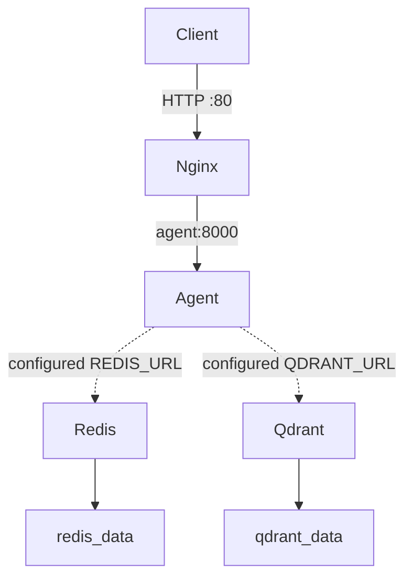

# Day 14 Lab — Mission Answers

## CP0 — Setup

- Repository: đúng mẫu tên Day 14; remote origin thuộc tài khoản cá nhân, nhánh main.
- Python Windows: 3.15.2; môi trường làm bài chọn Ubuntu 24.04 WSL, Python 3.12.3, os.name = posix.
- Docker Compose trên Windows: v5.5.1.
- Đã tạo virtual environment WSL tại ~/.venvs/k5day14 và cài dependencies Part 1 thành công.
- Docker Desktop đã được bật và kiểm tra lại thành công: Docker Engine 29.8.1, Docker Compose v5.5.1 trên WSL. Lệnh docker run --rm hello-world trả về Hello from Docker! trên cả Windows và Ubuntu-24.04 WSL. Python 3.12.3 trong virtual environment vẫn hoạt động. CP0 đạt toàn bộ yêu cầu setup đã kiểm tra.

## Part 1 — Localhost vs Production (CP1)

### Exercise 1.1 — Anti-patterns

Các dòng dưới đây thuộc `01-localhost-vs-production/develop/app.py`.

1. Dòng 17–18: API key mẫu và database URL được hardcode, dễ lộ thông tin nếu dùng credential thật và khó đổi theo môi trường.
2. Dòng 21–22: DEBUG và MAX_TOKENS cố định trong source, không có quản lý cấu hình theo môi trường.
3. Dòng 33–38: dùng print để ghi cả câu hỏi, câu trả lời và key; dễ lộ dữ liệu, khó lọc log tập trung.
4. Dòng 42–43: thiếu endpoint health check chuyên biệt để platform kiểm tra liveness.
5. Dòng 51: bind localhost, không nhận traffic từ bên ngoài container.
6. Dòng 52: port 8000 cố định, không tuân theo PORT do cloud cấp.
7. Dòng 53: reload=True gây overhead và không phù hợp production.
8. Không khai báo lifecycle startup/shutdown để quản lý và giải phóng tài nguyên; Uvicorn vẫn có cơ chế shutdown mặc định.

### Exercise 1.2 — Chạy bản develop

Chạy trong WSL Ubuntu 24.04, Python 3.12.3 với dependencies từ requirements.txt và PYTHONPATH trỏ gốc repo. Dùng Uvicorn trực tiếp để không bật reload khi kiểm thử.

```bash
python -m uvicorn app:app --host 127.0.0.1 --port 8000
curl -i -X POST "http://127.0.0.1:8000/ask?question=Hello"
```

Output thực tế (25/11/2026, lược bỏ header không cần thiết):

```text
HTTP/1.1 200 OK
{"answer":"Tôi là AI agent được deploy lên cloud. Câu hỏi của bạn đã được nhận."}
```

Đây là câu trả lời mock chạy local, không chứng minh đã deploy cloud. API chạy được nhưng chưa production-ready vì các vấn đề ở Exercise 1.1.

### Exercise 1.3 — So sánh với advanced

| Feature | Develop | Production | Tại sao quan trọng? |
| --- | --- | --- | --- |
| Config | Hardcode, dòng 17–22 | config.py đọc env, validate | Đổi cấu hình không sửa code, không đưa secret vào Git |
| Health check | Không có | /health dòng 135–149, /ready dòng 152–161 | Phân biệt process sống với khả năng nhận request |
| Logging | print và log key, dòng 33–38 | Logging có format JSON dòng 28–31, chỉ ghi metadata dòng 110–122 | Dễ tìm lỗi và giảm lộ dữ liệu; formatter mẫu vẫn cần xử lý escaping khi dùng thực tế |
| Shutdown | Không có lifecycle riêng | lifespan dòng 39–67, Uvicorn xử lý shutdown | Cho phép hoàn tất request và cleanup tài nguyên |
| Host/port | localhost:8000 dòng 51–52 | settings.host, settings.port dòng 196–197 | Nhận kết nối từ bên ngoài container, phù hợp cloud |
| Debug | reload=True dòng 53 | settings.debug dòng 198, mặc định false | Giảm overhead production |
| Input | Query parameter | JSON body, kiểm tra question dòng 102–108 | Hợp đồng API rõ hơn |

Đã tắt develop trước khi chạy production/app.py (config mặc định, mock LLM). Kết quả thực tế:

```text
GET /health — HTTP/1.1 200 OK
{"status":"ok","uptime_seconds":0.6,"version":"1.0.0","environment":"development","timestamp":"2026-11-25T07:41:21.501827+00:00"}
GET /ready — HTTP/1.1 200 OK
{"ready":true}
POST /ask (JSON {"question":"Hello"}) — HTTP/1.1 200 OK
{"question":"Hello","answer":"Tôi là AI agent được deploy lên cloud. Câu hỏi của bạn đã được nhận.","model":"gpt-4o-mini"}
INFO:     Shutting down
INFO:     Waiting for application shutdown.
INFO:     Application shutdown complete.
```

Ví dụ cụ thể: develop/app.py dòng 52 cố định port 8000, production/app.py dòng 197 dùng settings.port, được đọc từ PORT trong config.py. Health check giúp phát hiện process lỗi, readiness giúp điều phối traffic; graceful shutdown giúp giảm request bị ngắt. Bản advanced là ví dụ cải tiến, chưa chứng minh đủ tiêu chí Part 6.

## Part 2 — Docker (CP2)

### Exercise 2.1 — Dockerfile cơ bản

1. Base image: `python:3.11`, bản Python đầy đủ.
2. Working directory: `/app`; các lệnh COPY, RUN và CMD làm việc từ đây nếu dùng đường dẫn tương đối.
3. COPY requirements.txt trước source giúp cache layer pip install; thay đổi app.py không buộc cài lại dependencies nếu requirements không đổi.
4. CMD đặt lệnh hoặc tham số mặc định, có thể ghi đè bằng đối số docker run. ENTRYPOINT định nghĩa executable chính, thường kết hợp CMD làm tham số mặc định; có thể thay bằng --entrypoint.

### Exercise 2.2 — Build và run

Chạy từ gốc repo:

```bash
docker build -f 02-docker/develop/Dockerfile -t my-agent:develop .
docker run -d --name k5-day14-cp2-dev -p 127.0.0.1:8000:8000 my-agent:develop
curl -i http://127.0.0.1:8000/health
curl -i -X POST 'http://127.0.0.1:8000/ask?question=What%20is%20Docker%3F'
docker logs --tail 8 k5-day14-cp2-dev
docker exec k5-day14-cp2-dev python --version
docker rm -f k5-day14-cp2-dev
```

Output thực tế ngày 25/11/2026 (lược bỏ header):

```text
GET /health — HTTP/1.1 200 OK
{"status":"ok","uptime_seconds":1.2,"container":true}
POST /ask — HTTP/1.1 200 OK
{"answer":"Container là cách đóng gói app để chạy ở mọi nơi. Build once, run anywhere!"}
Python 3.11.18
```

Endpoint develop nhận question qua query parameter theo README. docker logs xác nhận server Uvicorn và hai endpoint trả 200.

### Exercise 2.3 — Multi-stage build

Stage builder dùng python:3.11-slim, cài gcc, libpq-dev và Python dependencies vào /root/.local. Stage runtime dùng base slim mới, chỉ copy packages đã cài và source, chạy bằng appuser non-root, có HEALTHCHECK và 2 Uvicorn workers. Không mang build tools sang runtime.

```bash
docker build -f 02-docker/production/Dockerfile -t my-agent:advanced .
docker images my-agent
docker image inspect my-agent:develop my-agent:advanced --format '{{.RepoTags}} {{.Size}}'
```

| Image | ID | Disk usage (docker images) | Content size | Size (bytes, inspect) |
| --- | --- | --- | --- | ---: |
| my-agent:develop | 47f32f42f8f1 | 1.67 GB | 426 MB | 1667783957 |
| my-agent:advanced | 1ba7fb337d63 | 240 MB | 57.4 MB | 239815436 |

Dung lượng theo MB thập phân: 1667.783957 MB và 239.815436 MB. Giảm (1667783957 - 239815436) / 1667783957 x 100 = 85.62%. Image advanced dưới 500 MB. Docker HEALTHCHECK đánh dấu tình trạng container; Docker standalone không tự restart chỉ vì unhealthy.

### Exercise 2.4 — Docker Compose



Bốn service cùng mạng bridge internal, chỉ Nginx publish port 80/443 (chưa có TLS listener trong cấu hình mẫu). Agent phụ thuộc healthcheck Redis và Qdrant; bản main.py mẫu dùng Mock LLM, chưa thực sự truy vấn hai dịch vụ này. Compose khởi động một container agent (hai worker), không phải hai replica như comment. Nginx proxy vào agent:8000, rate limit theo IP. Volume lưu dữ liệu Redis và Qdrant.

Tạo .env.local rỗng (không commit), chạy compose với project riêng:

```bash
docker compose -p k5-day14-docker -f 02-docker/production/docker-compose.yml up -d --build --wait
docker compose -p k5-day14-docker -f 02-docker/production/docker-compose.yml ps
curl -i http://127.0.0.1/health
curl -i -X POST http://127.0.0.1/ask -H 'Content-Type: application/json' -d '{"question":"Explain microservices"}'
docker compose -p k5-day14-docker -f 02-docker/production/docker-compose.yml exec -T agent id
```

Output thực tế: agent, redis, qdrant healthy; nginx Up. Qua Nginx:

```text
GET /health — HTTP/1.1 200 OK
Server: nginx
{"status":"ok","uptime_seconds":5.0,"version":"2.0.0","timestamp":"2026-11-25T07:52:27.377287"}
POST /ask — HTTP/1.1 200 OK
Server: nginx
{"answer":"Tôi là AI agent được deploy lên cloud. Câu hỏi của bạn đã được nhận."}
uid=999(appuser) gid=999(appuser) groups=999(appuser)
```

Log Nginx xác nhận POST /ask 200. Đã dọn stack bằng docker compose -p k5-day14-docker -f 02-docker/production/docker-compose.yml down -v. Compose cảnh báo version obsolete nhưng không ảnh hưởng test.

## AI log

- CP0: dùng ChatGPT kiểm tra môi trường, đọc hướng dẫn WSL và chạy các lệnh setup; kết quả ghi theo output thực tế. Sau khi học viên bật Docker Desktop, AI chạy lại hello-world trên cả Windows và WSL; cả hai thành công.

- CP1: dùng ChatGPT gợi ý phân tích anti-pattern và bảng so sánh, chạy thử hai server local và ghi output thực tế. Không sửa code mẫu. Học viên cần đọc lại, xác nhận các giải thích và tự kiểm tra bằng các lệnh trên.

- CP2: dùng ChatGPT đọc Dockerfile, gợi ý giải thích cache/multi-stage, chạy build, đo size bằng Docker, test container và Compose qua Nginx, ghi số liệu thực tế. Không sửa source mẫu; học viên cần đọc lại và tự xác nhận kết quả.
